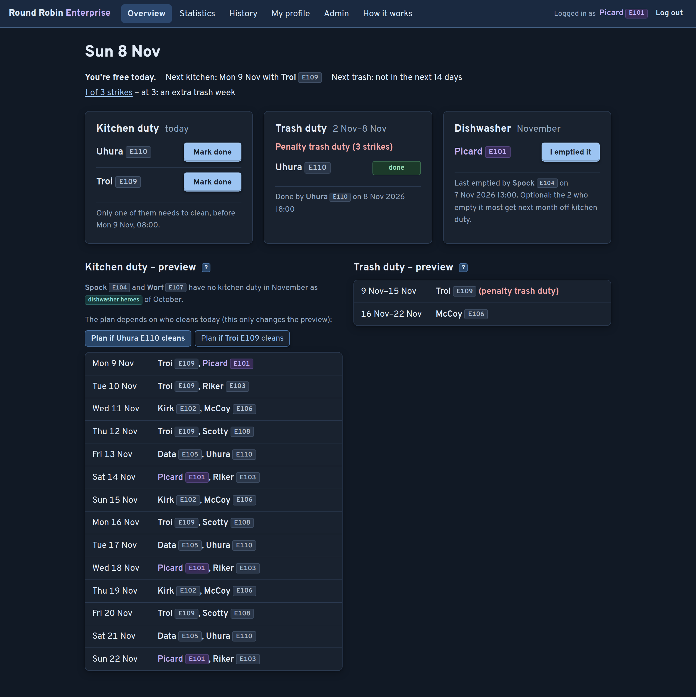
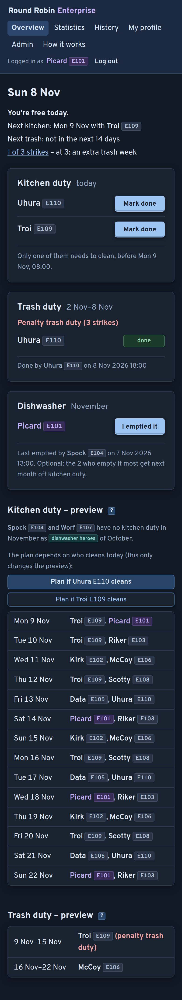

# Round Robin

Web app for the cleaning duties on a dorm floor: assigns kitchen and trash duty fairly,
tracks who did it and gives strikes for missed duties. Whoever empties the dishwasher most
gets a month off kitchen duty. The UI is in English.

## Screenshots



<details><summary>On a phone</summary>



</details>

## Rules

**Duties**
- Kitchen duty: daily, 2 people, one of them cleans.
- Trash duty: weekly (Mon–Sun), 1 person.
- Whoever cleaned clicks "Done" (only on their own duty, from its first day until the
  deadline). The other person becomes "not needed".
- A mis-tapped "Done" can be undone for 10 minutes by whoever marked it (not after the
  deadline, and not once the duty was disputed).
- Deadline: 8:00 the day after the duty ends. After that the duty is "missed".
- Each day's people (on Monday also the week's trash person) are chosen at 8:05, right
  after the previous duty's deadline. Until then the overview still shows the previous duty.
- Statuses: open, done, missed, not needed, excused, disputed.

**Fairness**

This is the fair carpool algorithm (Fagin & Williams, 1983): each kitchen day or trash week
is a trip, everyone available (active, not away) rides along, and whoever cleans drives.
Each trip that someone cleaned is split equally among its riders. Score = duties
cleaned − shares. The lowest score goes next; ties go to whoever cleaned longest ago (never
cleaned = first). Being put on a duty without cleaning doesn't move you back.
Example with 15 residents: a trip takes 1/15 ≈ 0.07 from everyone, the person who cleans
ends at 1 − 0.07 ≈ +0.93. All scores sum to 0, except for those of residents who moved out.
The statistics page shows scores as whole points, 100 per duty (+93 and −7 in the example),
rounded so that they still sum to 0.
- Away or paused: not riding, so no share for that time.
- New residents start at 0.
- Only the person who cleaned gets the point.
- A trip nobody cleaned (missed, excused or disputed) counts for nobody: no share, no
  point. Whoever missed it still has the lowest score and comes up again soon.
- Kitchen and trash are counted separately; penalty weeks not at all.

**Strikes**
- Given for a missed duty (everyone on it), a disputed "Done", or by hand.
- Marking a missed duty done or excusing it later revokes its strikes.
- 3 strikes → penalty trash duty: the next trash week without an assignment in which the person
  isn't away. It replaces the regular trash duty, doesn't count for fairness and uses up the
  3 strikes.

**Dishwasher**
- Whoever empties the dishwasher clicks "I emptied it" on the overview.
- One emptying counts for one person: after someone marks it, nobody can mark it again for
  1:30h.
- Counted per calendar month. The 2 residents with the most emptyings become **dishwasher
  heroes**: no kitchen duty for the whole next month. That month counts like being away (for
  kitchen only), so they don't have to catch up afterwards. Trash duty stays as usual.
- A mis-tap can be taken back for 10 minutes by whoever marked it.
- Ties: whoever reached the count first wins.
- The floor speaker can delete wrong entries of the current month; earlier months are final.

**Absences** ("Away", on "My profile"): not picked during that time. A duty you already
have stays yours (the floor speaker can excuse it); a penalty week moves to your next free
week.

**Floor speaker (admin)**, on "Admin"
- Add, edit, pause ("Deactivate") and delete ("Delete (moved out)") residents; hand over the
  floor speaker role.
- Mark any duty done (also after the deadline), excuse it ("Excuse": no strike, no
  credit) or dispute it ("Dispute", also on "History": the claimer loses the credit and
  gets a strike). A missed duty can also just stay missed ("Keep missed": the strike stays
  and it leaves "Needs attention"; it can still be marked done or excused later).
- Give and revoke strikes; enter absences for residents; delete wrong dishwasher entries;
  run the daily job by hand.
- Move-out/in: delete the old resident and add the new one as a new account (don't rename).
  The history stays as "former resident"; nobody inherits the share.
- Room numbers like `E103`: building, floor, room 01–99.

**Daily job** (8:05): marks missed duties and gives the strikes, then assigns
today's kitchen and this week's trash duty. Residents who become unavailable (away, paused,
deleted) are replaced on their open duties immediately.

## Pages

Everything except the login page needs a login, so nobody else on the network sees names,
rooms or duties. Logging out logs you out on all your devices; changing your password (or
the floor speaker setting a new one) logs out all other devices.

| Page | Access | Content |
|---|---|---|
| Overview | login | Today's duties, the dishwasher, plan for the next 14 days. Until today's kitchen duty is marked, the plan depends on who cleans: one plan per person, picked above it |
| Statistics | login | Per resident: done, missed, points (score × 100), strikes, dishwasher this month, heroes |
| History | login | Duty history, 4 weeks per page |
| My profile | login | Absences, strikes, recent duties, password |
| How it works | login | The rules, for new residents |
| Admin | floor speaker | Admin functions |

## Settings

In `.env`, see `.env.example`.

| Setting | Default | Meaning |
|---|---|---|
| `SECRET_KEY` | – | Required, ≥ 32 chars (`openssl rand -hex 32`). Signs the session cookie. |
| `POSTGRES_PASSWORD` | `e1` | Database password. Use a random one on a server. |
| `DATABASE_URL` | local database | Only needed outside Docker. |
| `TIMEZONE` | `Europe/Berlin` | Time zone for dates and deadlines. |
| `FLOOR_NAME` | – | Optional floor name in the header ("Round Robin E1"). |
| `DEADLINE_HOUR` | `8` | Deadline hour on the day after a duty; the next people are chosen right after it. |
| `KITCHEN_PEOPLE_PER_DAY` | `2` | People per kitchen duty. |
| `TRASH_PEOPLE_PER_WEEK` | `1` | People per trash duty. |
| `STRIKE_THRESHOLD` | `3` | Strikes per penalty week. |
| `DISHWASHER_COOLDOWN_MINUTES` | `90` | Minutes after an emptying before the next one can be marked. |
| `DISHWASHER_HEROES` | `2` | How many of a month's top emptiers get the next month off kitchen duty. |
| `PREVIEW_DAYS` | `14` | Days shown in the plan. |
| `ADMIN_USERNAME`, `ADMIN_PASSWORD`, `ADMIN_NAME`, `ADMIN_ROOM` | – | Optional first floor speaker, see below. |

## Tech stack

- **Backend:** Python 3.12, FastAPI, APScheduler for the daily job
- **Database:** PostgreSQL 16, SQLAlchemy (async, asyncpg), Alembic migrations
- **Frontend:** server-rendered Jinja templates, htmx for page loads without a full reload
  and in-place updates, plain CSS. No JavaScript build step.
- **Auth:** signed session cookie (itsdangerous), passwords hashed with Argon2 (pwdlib)
- **Config:** pydantic-settings, read from `.env`
- **Tooling:** uv, pytest, ruff, GitHub Actions CI
- **Deployment:** Docker Compose (app + database)

## Setup

```bash
cp .env.example .env                    # set SECRET_KEY: openssl rand -hex 32
docker compose up -d --build            # database + app, http://localhost:8000
docker compose exec app python scripts/create_admin.py   # first floor speaker
```

- **First floor speaker without the script:** set the `ADMIN_*` variables in `.env`. The app
  creates the account on startup only while there are no users, so a deleted admin doesn't
  come back.
- **Server:** set a random `POSTGRES_PASSWORD` before the first start (later changes need
  `ALTER USER <user> PASSWORD '...'` in the database).
- **Update:** `docker compose up -d --build`. Migrations run on every start.
- **Test residents:** `docker compose exec app python scripts/seed.py`. Add
  `--days 30` (on an empty database) for a simulated month of duties, misses and strikes.
- **Reset:** `docker compose down -v` deletes the database.

Development with auto-reload (database in Docker, app local):

```bash
docker compose up -d db
uv sync
uv run alembic upgrade head
uv run fastapi dev app/main.py          # http://localhost:8000
```

## Tests

```bash
uv run pytest   # needs the database from `docker compose up -d db`
uv run ruff check . && uv run ruff format --check .   # lint, as in CI
```

## Code

- `app/services/carpool.py`: the fairness logic, without database (start reading here)
- `app/services/`: the other rules (duties, strikes, dishwasher, users, login, daily job)
- `app/web.py`: pages and form actions; templates in `app/templates/`
- `app/models.py`: database tables; migrations in `migrations/`
- `scripts/`: create the first floor speaker, add test residents
